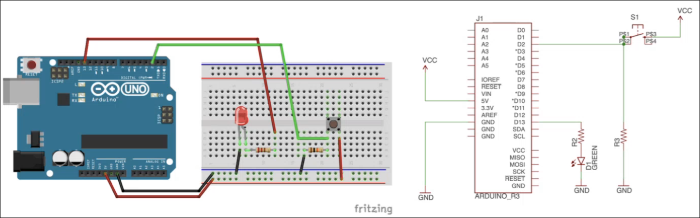

# Note per il primo assignment

Per stampare le stringhe usa:
```cpp
Serial.print("Ciao");
```

Prima devi avere impostato:
```cpp
Serial.begin(9600); //baud rate (servono per sincronizzare i bit sul canale)
```

You can pass flash-memory based strings to Serial.print() by wrapping them with F(). For example:
```cpp
Serial.print(F("Hello World"))
```

> [!NOTE]
> A cosa serve la roba qui sopra?

Dichiarare una variabile `static` dentro una funzione fa si che quella variabile venga dichiarata solo alla prima chiamata e poi rimane il valore della chiamata precedente.
L'ho utilizzata in core.cpp

* Arduino supporta interrupt solo nei pin 2 e 3, ecco perchè colleghiamo i bottoni a questi pin

---

## Architettura

Guardando il codice qui: `https://github.com/pslab-unibo/esiot-2026-2027/blob/master/lab-activities/lab-activity-03/superloop_interrupt_example/`:
`react.ino` deve restare il più semplice possibile.
Ci metti solo uno switch che a seconda dello stato in cui ci si trova chiama una funzionalità di `core.cpp` (`kernel.h` gestisce i cambiamenti tra stati).
Gli stati possibili sono definiti in `core.h`; in `core.cpp` sono definite le operazioni da svolgere (funzioni da chiamare) nel caso ci si trovi in un qualche stato.
Il modulo input è abbastanza auto esplicativo... gestisce il potenziometro e i buttons in questo caso
Il modulo output è usato per azionare i led (anche il display?)

> [!NOTE]
> per attivare la modalità debug (stampa messaggi nel serial monitor) scommenta la riga in kernel.h

---

## Circuiti

Per i LED dovrebbe andare bene un resistore da 220Ω.
Per i bottoni invece serve una resistenza "pull-down" (mette giù il segnale quando il bottone non è premuto, altrimenti si potrebbero leggere dei valori inesatti (non proprio LOW)).
Il resistore del bottone è di circa 10kΩ.

Quando premiamo il bottone vogliamo che il pin 2 passi da LOW a HIGH per rilevare il pin premuto (o HIGH a LOW).
Quando il bottone è premuto infatti, il circuito è chiuso e i 5V del VCC arrivano direttamente al pin 2 che quindi rileva HIGH.
Quando non è chiuso invece il pin 2 è collegato a GND e leggerebbe un LOW certo.
La resistenza serve perchè se il bottone è premuto vogliamo impedire che la corrente passi per suo il ramo perchè creerebbe un corto circuito.

Ciò accade perchè i campi elettromagnetici generati dal circuito indurrebbero una mini corrente (quindi un voltaggio) al pin 2 (molto sensibile dato che ha una resistenza interna grandissima) che potrebbe rilevare come un passaggio ad HIGH.
Per evitare ciò si "ancora" saldamente a GND e questo problema non si verifica, legge sempre 0V.

> [!NOTE]
> Per prendere l'input dai bottoni puoi farlo con un polling continuo oppure con gli interrupt (meglio)

Non cercare di fare un circuito con tutti i componenti collegati che funzionano tra di loro meccanicamente... l'arduino serve proprio per questo ("per fare la logica")

