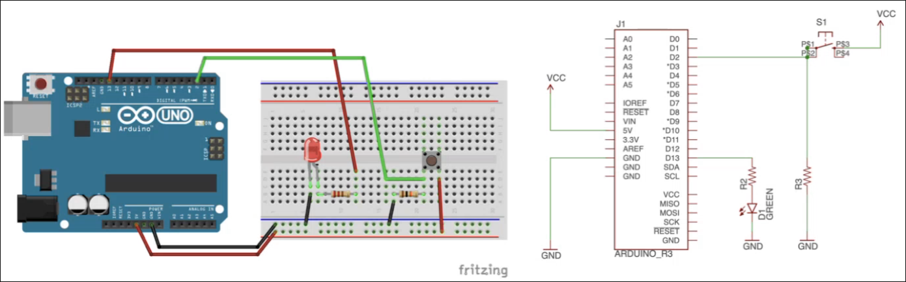
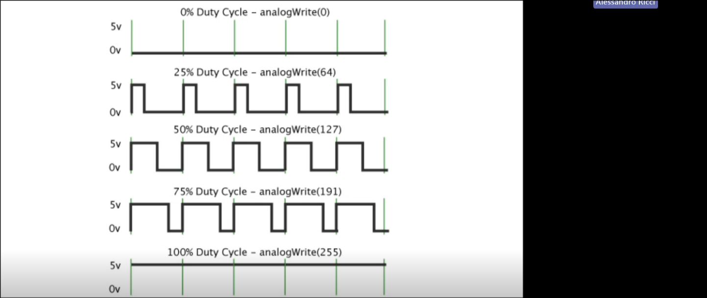
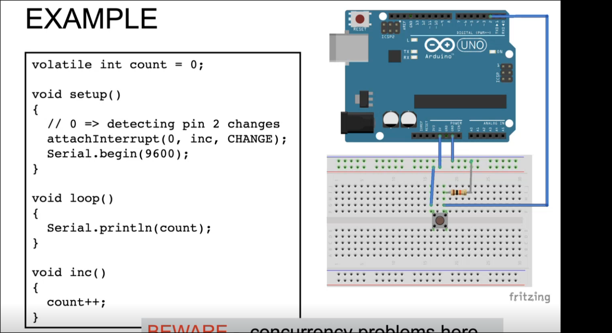

# Appunti registrazione 17 Settembre

## Architettura

I microcontrollori hanno tutto sullo stesso chip (System on Chip): hanno la cpu, memoria RAM, ROM, DACs, timers, ...
Questo permette di avere dispositivi anche molto piccoli.

La `CPU` di arduino UNO ha 32 registri general-purpose a [8bit] e lavora a [16Mhz]. È l'ATMega328P (questo e' il microcontrollore!).
Abbiamo [14 pin] per l'I\O digitale e [6 pin] per gli input analogici.
È un processore RISC.
C'è un registro speciale a 16 bit usato per gestire gli indirizzi di memoria (da 2KiB).

> [!NOTE]
> I registri sono mappati nella memoria SRAM del microcontrollore!
> Per accedere ai registri quindi devi accedere a una particolare area di memoria (all'inizio della SRAM)

In generale i microcontrollori lavorano a 5V o 3.3V (due famiglie). Questo significa che il valore HIGH su un pin sta a 5V o 3.3V.
Questi dispositivi consumano pochissima corrente: circa 40mA.

Ovviamente non c'è nessun tipo di Sistema Operativo!
Semplicemente uploadi il tuo programma (già compilato) e lui esegue quello.

Scriviamo in C/C++ perchè così il codice è portabile su altri microcontrollori (la cui architettura può cambiare, ...).
E poi è un livello di astrazione più alto rispetto Assembly.

Architettura Von Neumann (Fetch, decode, Execute, `Check Interrupt` (process it)):
Il microcontrollore dell'Arduino UNO è collegato tramite bus alla memoria flash (memoria persistente) su cui carichiamo i programmi e la SRAM (che e' quella volatile).
Nella memoria flash c'e' anche il `boot loader` che e' del codice che permette all'arduino di trovare il programma che ha caricato nella flash (se c'è) e caricarlo nella SRAM.
Se il programma non c'è allora si mette ad ascoltare la Serial line per vedere se qualcuno glielo carica.

### Architettura Harvard

Più precisamente questi microcontrollori usano l'architettura `Harvard` che è una variante di quella di Von Neumann:
In questo caso sia i dati che le istruzioni sono memorizzati in aree di memoria fisicamente diverse e si usano Bus diversi.
Ad esempio solitamente il codice risiede nella memoria FLASH (lettura veloce ma scrittura lenta (tanto devo solo leggere il codice, lo scrivo solo una volta all'inizio)), invece i dati stanno in SRAM (lettura e scrittura veloci (costi più alti e richiede più energia))

> [!NOTE]
> Anche nei computer di oggi si ha una architettura simile ma non fisicamente...
> Infatti la memoria virtuale che è gestita dal Sistema Operativo è organizzata in pagine che di solito sono divise tra pagine data e code.
> Questo semplifica la gestione della sicurezza (non puoi scrivere nelle pagine code...)

> [!NOTE]
> Oltre alla SRAM in arduino UNO c'è anche la EEPROM (piccola, solo 1 kilobyte) che è persistente invece (usata per un particolare tipo di dati (?)).

Abbiamo una memoria molto limitata, quindi usala con parsimonio.

## SUPERLOOP Architecture

Prima si esegue l'setup() e poi si esegue loop() all'infinito.
È come avere:
```c
int main(void){
    setup();
    while(true){
        loop();
        // arduino a questo punto fa anche un check per vedere se c'e' qualcosa sulla Serial Line
        // per questo motivo non devi assolutamente fare una funzione loop che non termina mai, altrimenti non viene mai checkata la Serial Line.
    }
}
```

* Pro:
    * Semplice;
    * Reliable;
* Cons:
    * timing non accurato (se fai il polling all'inizio del loop e il loop è molto grosso potresti perderne qualcuno);
    * alto consumo di potenza (vedremo come metterlo in sleep);

## GPIO

Ci sono 14 pin che possono essere usati sia per l'input che per l'output digitale (general purpose).
Puoi scrivere HIGH o LOW oppure leggere HIGH o LOW (o il CHANGE).

Poi ci sono 6 pin per l'input (SOLO INPUT) analogico.
Qui puoi settare un voltaggio tra 0 a 5V.

Ogni pin può anche avere funzionalità aggiuntive.

Ci sono dei registri apposta nell'ATMega328P che ti permettono di settare un dato pin come INPUT o OUTPUT e altri che ti permettono di leggere/scrivere su questi pin.
Noi non arriveremo mai a questo livello, useremo semplicemente le funzioni `pinMode()` (setta la direzione del pin, INPUT o OUTPUT), `digitalWrite()` (scrive HIGH o LOW su un pin), `digitalRead()` (legge se il pin è in HIGH o LOW).

### Esempio blinkare un LED:
```c
    #define LED_PIN 13 //e' il LED builtin

    void setup(){
        pinMode(LED_PIN, OUTPUT);
    }

    void loop(){
        digitalWrite(LED_PIN, HIGH);
        delay(1000);
        digitalWrite(LED_PIN, LOW);
        delay(1000);
    }
```

> [!IMPORTANT]
> `delay()` fa busy waiting, non è come la sleep di java che è una system call che chiede al sistema operativo di mettere in pausa il programma senza così fare busy waiting.

> [!NOTE]
> ricorda che quando fai `millis()` ti mostra il numero di millisecondi da quando è partito Arduino.

### Esempio Button-LED
Un bottone per l'input e un LED per l'output


Il bottone è collegato da una parte a vcc (5V), dall'altra a un pin di INPUT.
Quando clicco il bottone si chiude il circuito e nel pin di INPUT leggo HIGH (vcc, 5V).

All'inizio nel setup() setuppo gli input e gli output. Nel loop all'inzio pollo lo stato del pin di INPUT.
Se e' HIGH scrivo nel pin di OUTPUT HIGH, viceversa se è LOW scrivo in output (led) LOW.

Attenzione che il polling all'inzio può percepire uno stato che magari cambia istantaneamente dopo ma ormai per un loop intero rimane quello che hai rilevato all'inizio.

## Pin (multiplexed) Functions

Alcuni pin hanno ulteriori funzioni uniche:
Ad esempio i pin 2 e 3 possono gestire interrupt...

## Pin analogici
I pin analogici leggono valori da 0 a 5V. Vanno dal pin A0 al pin A5.
I valori che leggi tramite `analogRead(int PIN)` sono da 0 a 1023 (quindi 1024 valori).
Questo perchè Arduino UNO usa un Analog/digital Converter a 10bit (c'e' un registro fatto apposta da 10bit) di risoluzione.
Il convertitore prende il valore continuo da 0 a 5V e lo converte in un numero a 10bit.

## Serial Line

Utile per il logging.
L'arduino può comunicare con il computer tramite la Serial Line del cavo USB.
Per fare ciò l'arduino e il computer devono mettersi d'accordo su un baud rate in modo da leggere i bit che si scambiano in modo sincrono.

> [!NOTE]
> Anche lui consiglia di fare anche un test delle componenti (come pensavamo noi con test.cpp).

# Appunti registrazione 24 Settembre

## PWM (Simula Analog Out)

Arduino UNO non ha un pin analogico per l'output, non puo' mandare fuori segnali analogici.
Pero' ci sono alcuni pin che possono farlo simulando una cosa simile: Pulsw Width Modulation (PWM)

I pin GPIO 3, 5, 6, 9, 10 e 11 (hanno una "~" di fianco al numero) possono anche simulare un segnale analogico tramite PWM passando velocemente da HIGH a LOW.
La funzionalita' PWM si usa sfruttando la funzione `analogWrite()`.
La funzione analogWrite() accetta solo valori a 8bit (quindi VCC e' 255, la meta' e' 128, ...).
Piu' alto e' il duty cycle maggiore e' il valore analogico simulato (si passa da duty cycle del 0% per simulare GND al 100% per simulare VCC)


In questo modo puoi fare il fade dei LED (ma puoi dare in generale un input analogico a qualsiasi sensore/attutatore, ad esempio un motore).

> [!NOTE]
> I pin che supportano PWM sono gli stessi che hanno un timer!
> E come vedremo questo non e' per caso...

## INTERRUPTS

Come abbiamo gia' visto nel button led il polling puo' farti perdere degli eventi importanti (soprattutto se il loop() e' lungo)... non va bene.
Allora ci vengono in soccorso gli interrupt che sono segnali elettrici che passando dai PIN di GPIO arrivano direttamente alla CPU.
Se avessimo un sistema operativo sarebbe lui a gestirli: in linux una delle prime cose che il kernel fa dopo il boot e' setuppare la interrupt table in cui per ogni interrupt possibile associa un numero e una routine da eseguire quando accade.
Appena arrive un segnale di interrupt la cpu interrompe quello che stava facendo e viene presa la riga giusta della interrupt table ed eseguita la routine. La routine (o interrupt handler) viene eseguita in kernel mode. Se avviene un interrupt durante l'esecuzione di un altro interrupt handler dipende dall'implementazione del sistema operativo.
Ad esempio in Arduino AVR quando arriva un altro interrupt durante l'esecuzione di un handler, l'interrupt viene semplicemente scartato.
Nei sistemi operativi moderni invece esiste una queue per mettere in coda gli interrupt contemporanei.

In generale cio' funziona bene se la routine da eseguire e' abbastanza veloce.

In arduino non avendo OS e quindi nessuna interrupt table possiamo specificare noi cosa fare quando avviene un interrupt, quindi [programmando un nostro interrupt handler].

I pin di input 2 e 3 possono essere configurati per gestire interrupt (in realta' con la libreria EnableInterrupt puoi usare anche altri pin).
Puoi dire ai pin di generare un interrupt quando c'e' un cambiamento del segnale (RISING, FALLING o CHANGE) e quando il segnale e' LOW.

Alcuni interrupt sono gia' definiti, ad esempio quando clicchi il reset button.

### AttachInterrupt

La funzione `attachInterrupt(interruptNumber, ISR, mode)` serve per assegnare gli interrupt.
Ogni pin ha un suo interruptNumber specifico che puoi ottenere con la funzione `digitalPinToInterrupt(pin)`.
In ISR devi mettere la routine da chiamara (una tua funzione quindi). Infatti in c puoi passare funzioni come argomenti grazie ai puntatori a funzione. Per poter avere un puntatore a funzione devi avere una procedura (nessun output e nessun input). Infatti quando arriva l'interrupt la CPU deve avere semplicemente un indirizzo di memoria a cui andare per eseguire la routine, non una funzione vera e propria. (comunque anche da una procedura puoi accedere a variabili globali)

> [!NOTE]
> Sta spiegando che in un semplice circuito con un led la resistenza la puoi mettere sia tra vcc e il led sia tra il led e GND.
> Infatti la corrente che passa per il circuito e' sempre la stessa.
> Inoltre il LED e' un diodo e non ha una resistenza fissa ma ha un calo di tensione fisso. Vuole una corrente di qualche mA (arduino eroga 40mA, quindi c'e' bisogno di limitarla con una resistenza).
> Per decidere la resistenza da mettere devo vedere quanta corrente vuole il LED e usare la legge di Ohm.

## Attaccare un bottone (RESISTENZA PULLDOWN)

Un bottone serve solo ad aprire/chiudere un circuito.
Se connetto un bottone a VCC e un pin qualsiasi quando schiaccio il bottone, il circuito si chiude e nel pin posso rilevare un CHANGE (o HIGH) e fare partire un interrupt di conseguenza.

> [!WARNING]
> Ma c'e' un problema: quando il circuito e' chiuso voglio che il pin legga 0V precisi.

Cio' non accade perche' anche se il circuito, quando e' aperto, non e' collegato a nessun VCC, nella breadboard possono rimanere delle cariche che creano, anche se piccolissimi, differenze di potenziale (noise).
Basta anche poca carica per "fregare" il pin e leggere HIGH invece che LOW.
La soluzione e' collegare il pin anche a GND (oltre che al piedino del bottone) cosi' quando e' aperto, nel pin si leggono 0V di ferro.

> [!WARNING]
> Ora pero' sorge un altro problema. Infatti quando chiudi il circuito la corrente scorre direttamente da VCC a GND, corto circuito (secondo la legge di Ohm dovrebbe girare un sacco di corrente)! (rischi di spaccare l'arduino)

Si risolve anche questo mettendo una resistenza bella grossa nel ramo collegato a GND. In questo modo la corrente, scegliendo il path di meno resistenza, scorre verso il pin come volevamo.

> [!NOTE]
> Puoi anche invertire completamente questa logica: quando il circuito e' chiuso sei collegato a VCC e leggi HIGH, invece quando lo chiudi vuoi leggere LOW.
> Quindi il pin in questo caso e' direttamente collegato a VCC e con un altro ramo e' collegato al bottone, il bottone dall'altra parte e' collegato a GND.
> Quando chiudi il circuito (schiacci il bottone) si formerebbe come prima un corto circuito.
> Devi mettere una resistenza bella grossa (resistenza di PULLUP) nel ramo collegato al VCC per impedire il corto circuito.

### Esempio resistenza di pulldown

Il loop stampa sempre count, quando c'e' un interrupt si interrompe e viene eseguita inc() che incrementa il valore di count.

> [!IMPORTANT]
> inc() (in generale gli interrupt handlers) viene eseguita in modo atomico!

Se mentre si sta eseguendo inc() arriva un altro interrupt questo viene ingorato.

Perche' `volatile` in count?
Volatile serve a dire al compilatore di non fare ottimizzazioni. Quando si incrementa count devi andare sempre in memoria per leggere il suo valore.
Infatti normalmente quando si esegue l'istruzione println(count) il compilatore, vedendo che non viene mai chiamato inc e quindi non viene mai aggiornato count (viene solo passato il puntatore a inc ad attach interrupt), potrebbe decidere di compilare il programma scrivendo count come una costante (cachandola in un registro della CPU).

> [!WARNING]
> Nel codice qui sopra ci sono dei problemi di race conditions.

Infatti potrei cliccare il bottone nel momento esatto in cui si sta andando a leggere count (in questo programma la lettura di count sembra atomica ma in realta' nell'assembly sono piu' istruzioni, questo perche' count e' un int (che ha 16bit) e i registri della cpu sono solo a 8bit, quindi devo fare 2 MOV)

Invece non e' un problema se avviene un interrupt nel momento in cui si sta facendo count++ (anche se nemmeno questa e' atomica) perche' tanto neanche un interrupt puo' interrompere un interrupt handler.

Per risolvere questo problema (in un OS avrei semafori, ...) devo [disabilitare gli interrupt] prima della lettura di count e [riabilitarli] quando ho finito di leggere.
In questo modo rendo, in un certo senso quella lettura atomica!
Si usano le funzioni `noInterrupts()` per disabilitare e `interrupts()` abilitare gli interrupts.

### Esempio rivisitato senza race conditions
```c
#define BUTTON_PIN 2
volatile int count = 0;
int prev = 0;

void setup()
{
    Serial.begin(9600);
    attachInterrupt(digitalPinToInterrupt(BUTTON_PIN), inc, RISING);
}

void loop() {
    noInterrupts();
    int current = count;
    interrupts();

    // se voglio stampare solo quando cambia
    // if (current != prev) { 
    //     Serial.println(current);
    //     prev = current;
    // }
    //altrimenti faccio come prima e lo stampo sempre:
    Serial.println(count);
}

void inc() {
    count++;
}
```

## Timers

Anche qui si usano gli interrupt.
In pratica sono dei contatori che vengono incrementati e generano un interrupt quando al raggiungimento di un valore che decidi te.

> [!WARNING]
> Se disabiliti gli interrupt disabiliti anche i timer quindi!
> Quindi delay non funziona (e' basata su timer)

> [!NOTE]
> Anche durante l'esecuzione di un interrupt handler gli interrupt sono ignorati quindi anche i timer non funzionano.


