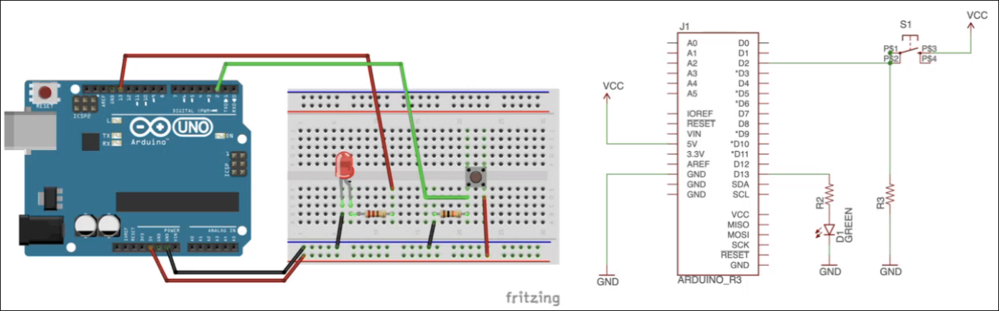
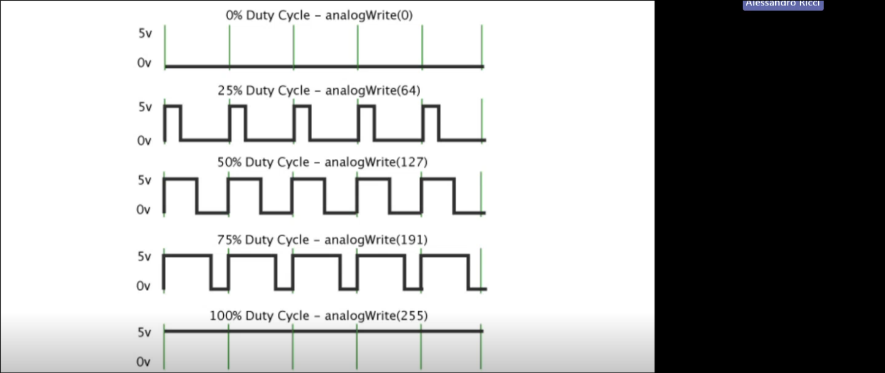
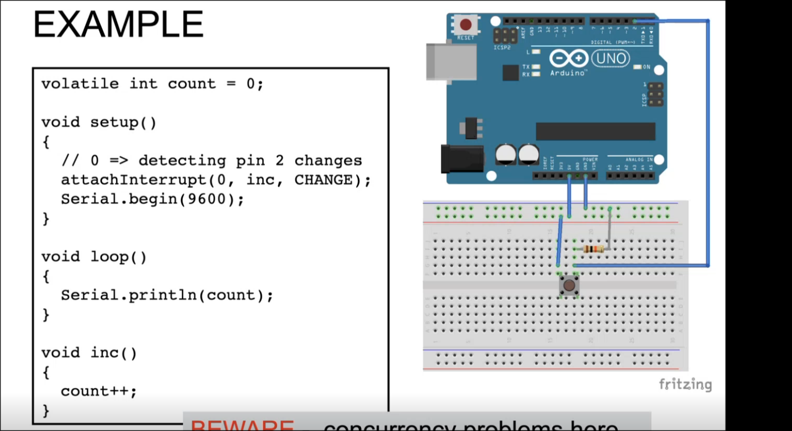
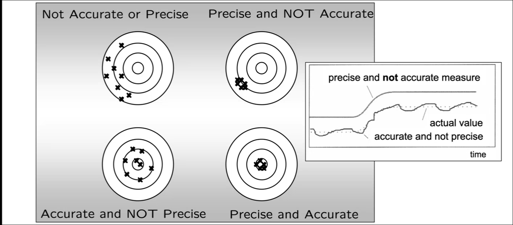

# Appunti registrazione 17 Settembre

## Architettura

I microcontrollori hanno tutto sullo stesso chip (System on Chip): hanno la cpu, memoria RAM, ROM, DACs, timers, ...
Questo permette di avere dispositivi anche molto piccoli.

La `CPU` di arduino UNO ha 32 registri general-purpose a [8bit] e lavora a [16Mhz]. È l'ATMega328P (questo e' il microcontrollore!).
Abbiamo [14 pin] per l'I\O digitale e [6 pin] per gli input analogici.
È un processore RISC.
C'è un registro speciale a 16 bit usato per gestire gli indirizzi di memoria (da 2KiB).

> [!NOTE]
> I registri sono mappati nella memoria SRAM del microcontrollore!
> Per accedere ai registri quindi devi accedere a una particolare area di memoria (all'inizio della SRAM)

In generale i microcontrollori lavorano a 5V o 3.3V (due famiglie). Questo significa che il valore HIGH su un pin sta a 5V o 3.3V.
Questi dispositivi consumano pochissima corrente: circa 40mA.

Ovviamente non c'è nessun tipo di Sistema Operativo!
Semplicemente uploadi il tuo programma (già compilato) e lui esegue quello.

Scriviamo in C/C++ perchè così il codice è portabile su altri microcontrollori (la cui architettura può cambiare, ...).
E poi è un livello di astrazione più alto rispetto Assembly.

Architettura Von Neumann (Fetch, decode, Execute, `Check Interrupt` (process it)):
Il microcontrollore dell'Arduino UNO è collegato tramite bus alla memoria flash (memoria persistente) su cui carichiamo i programmi e la SRAM (che e' quella volatile).
Nella memoria flash c'e' anche il `boot loader` che e' del codice che permette all'arduino di trovare il programma che ha caricato nella flash (se c'è) e caricarlo nella SRAM.
Se il programma non c'è allora si mette ad ascoltare la Serial line per vedere se qualcuno glielo carica.

### Architettura Harvard

Più precisamente questi microcontrollori usano l'architettura `Harvard` che è una variante di quella di Von Neumann:
In questo caso sia i dati che le istruzioni sono memorizzati in aree di memoria fisicamente diverse e si usano Bus diversi.
Ad esempio solitamente il codice risiede nella memoria FLASH (lettura veloce ma scrittura lenta (tanto devo solo leggere il codice, lo scrivo solo una volta all'inizio)), invece i dati stanno in SRAM (lettura e scrittura veloci (costi più alti e richiede più energia))

> [!NOTE]
> Anche nei computer di oggi si ha una architettura simile ma non fisicamente...
> Infatti la memoria virtuale che è gestita dal Sistema Operativo è organizzata in pagine che di solito sono divise tra pagine data e code.
> Questo semplifica la gestione della sicurezza (non puoi scrivere nelle pagine code...)

> [!NOTE]
> Oltre alla SRAM in arduino UNO c'è anche la EEPROM (piccola, solo 1 kilobyte) che è persistente invece (usata per un particolare tipo di dati (?)).

Abbiamo una memoria molto limitata, quindi usala con parsimonio.

## SUPERLOOP Architecture

Prima si esegue l'setup() e poi si esegue loop() all'infinito.
È come avere:
```c
int main(void){
    setup();
    while(true){
        loop();
        // arduino a questo punto fa anche un check per vedere se c'e' qualcosa sulla Serial Line
        // per questo motivo non devi assolutamente fare una funzione loop che non termina mai, altrimenti non viene mai checkata la Serial Line.
    }
}
```

* Pro:
    * Semplice;
    * Reliable;
* Cons:
    * timing non accurato (se fai il polling all'inizio del loop e il loop è molto grosso potresti perderne qualcuno);
    * alto consumo di potenza (vedremo come metterlo in sleep);

## GPIO

Ci sono 14 pin che possono essere usati sia per l'input che per l'output digitale (general purpose).
Puoi scrivere HIGH o LOW oppure leggere HIGH o LOW (o il CHANGE).

Poi ci sono 6 pin per l'input (SOLO INPUT) analogico.
Qui puoi settare un voltaggio tra 0 a 5V.

Ogni pin può anche avere funzionalità aggiuntive.

Ci sono dei registri apposta nell'ATMega328P che ti permettono di settare un dato pin come INPUT o OUTPUT e altri che ti permettono di leggere/scrivere su questi pin.
Noi non arriveremo mai a questo livello, useremo semplicemente le funzioni `pinMode()` (setta la direzione del pin, INPUT o OUTPUT), `digitalWrite()` (scrive HIGH o LOW su un pin), `digitalRead()` (legge se il pin è in HIGH o LOW).

### Esempio blinkare un LED:
```c
    #define LED_PIN 13 //e' il LED builtin

    void setup(){
        pinMode(LED_PIN, OUTPUT);
    }

    void loop(){
        digitalWrite(LED_PIN, HIGH);
        delay(1000);
        digitalWrite(LED_PIN, LOW);
        delay(1000);
    }
```

> [!IMPORTANT]
> `delay()` fa busy waiting, non è come la sleep di java che è una system call che chiede al sistema operativo di mettere in pausa il programma senza così fare busy waiting.

> [!NOTE]
> ricorda che quando fai `millis()` ti mostra il numero di millisecondi da quando è partito Arduino.

### Esempio Button-LED
Un bottone per l'input e un LED per l'output


Il bottone è collegato da una parte a vcc (5V), dall'altra a un pin di INPUT.
Quando clicco il bottone si chiude il circuito e nel pin di INPUT leggo HIGH (vcc, 5V).

All'inizio nel setup() setuppo gli input e gli output. Nel loop all'inzio pollo lo stato del pin di INPUT.
Se e' HIGH scrivo nel pin di OUTPUT HIGH, viceversa se è LOW scrivo in output (led) LOW.

Attenzione che il polling all'inzio può percepire uno stato che magari cambia istantaneamente dopo ma ormai per un loop intero rimane quello che hai rilevato all'inizio.

## Pin (multiplexed) Functions

Alcuni pin hanno ulteriori funzioni uniche:
Ad esempio i pin 2 e 3 possono gestire interrupt...

## Pin analogici
I pin analogici leggono valori da 0 a 5V. Vanno dal pin A0 al pin A5.
I valori che leggi tramite `analogRead(int PIN)` sono da 0 a 1023 (quindi 1024 valori).
Questo perchè Arduino UNO usa un Analog/digital Converter a 10bit (c'e' un registro fatto apposta da 10bit) di risoluzione.
Il convertitore prende il valore continuo da 0 a 5V e lo converte in un numero a 10bit.

## Serial Line

Utile per il logging.
L'arduino può comunicare con il computer tramite la Serial Line del cavo USB.
Per fare ciò l'arduino e il computer devono mettersi d'accordo su un baud rate in modo da leggere i bit che si scambiano in modo sincrono.

> [!NOTE]
> Anche lui consiglia di fare anche un test delle componenti (come pensavamo noi con test.cpp).

# Appunti registrazione 24 Settembre

## PWM (Simula Analog Out)

Arduino UNO non ha un pin analogico per l'output, non puo' mandare fuori segnali analogici.
Pero' ci sono alcuni pin che possono farlo simulando una cosa simile: Pulsw Width Modulation (PWM)

I pin GPIO 3, 5, 6, 9, 10 e 11 (hanno una "~" di fianco al numero) possono anche simulare un segnale analogico tramite PWM passando velocemente da HIGH a LOW.
La funzionalita' PWM si usa sfruttando la funzione `analogWrite()`.
La funzione analogWrite() accetta solo valori a 8bit (quindi VCC e' 255, la meta' e' 128, ...).
Piu' alto e' il duty cycle maggiore e' il valore analogico simulato (si passa da duty cycle del 0% per simulare GND al 100% per simulare VCC)


In questo modo puoi fare il fade dei LED (ma puoi dare in generale un input analogico a qualsiasi sensore/attutatore, ad esempio un motore).

> [!NOTE]
> I pin che supportano PWM sono gli stessi che hanno un timer!
> E come vedremo questo non e' per caso...

## INTERRUPTS

Come abbiamo gia' visto nel button led il polling puo' farti perdere degli eventi importanti (soprattutto se il loop() e' lungo)... non va bene.
Allora ci vengono in soccorso gli interrupt che sono segnali elettrici che passando dai PIN di GPIO arrivano direttamente alla CPU.
Se avessimo un sistema operativo sarebbe lui a gestirli: in linux una delle prime cose che il kernel fa dopo il boot e' setuppare la interrupt table in cui per ogni interrupt possibile associa un numero e una routine da eseguire quando accade.
Appena arrive un segnale di interrupt la cpu interrompe quello che stava facendo e viene presa la riga giusta della interrupt table ed eseguita la routine. La routine (o interrupt handler) viene eseguita in kernel mode. Se avviene un interrupt durante l'esecuzione di un altro interrupt handler dipende dall'implementazione del sistema operativo.
Ad esempio in Arduino AVR quando arriva un altro interrupt durante l'esecuzione di un handler, l'interrupt viene semplicemente scartato.
Nei sistemi operativi moderni invece esiste una queue per mettere in coda gli interrupt contemporanei.

In generale cio' funziona bene se la routine da eseguire e' abbastanza veloce.

In arduino non avendo OS e quindi nessuna interrupt table possiamo specificare noi cosa fare quando avviene un interrupt, quindi [programmando un nostro interrupt handler].

I pin di input 2 e 3 possono essere configurati per gestire interrupt (in realta' con la libreria EnableInterrupt puoi usare anche altri pin (con limitazioni)).
Puoi dire ai pin di generare un interrupt quando c'e' un cambiamento del segnale (RISING, FALLING o CHANGE) e quando il segnale e' LOW.

Alcuni interrupt sono gia' definiti, ad esempio quando clicchi il reset button.

### AttachInterrupt

La funzione `attachInterrupt(interruptNumber, ISR, mode)` serve per assegnare gli interrupt.
Ogni pin ha un suo interruptNumber specifico che puoi ottenere con la funzione `digitalPinToInterrupt(pin)`.
In ISR devi mettere la routine da chiamara (una tua funzione quindi). Infatti in c puoi passare funzioni come argomenti grazie ai puntatori a funzione. Per poter avere un puntatore a funzione devi avere una procedura (nessun output e nessun input). Infatti quando arriva l'interrupt la CPU deve avere semplicemente un indirizzo di memoria a cui andare per eseguire la routine, non una funzione vera e propria. (comunque anche da una procedura puoi accedere a variabili globali)

> [!NOTE]
> Sta spiegando che in un semplice circuito con un led la resistenza la puoi mettere sia tra vcc e il led sia tra il led e GND.
> Infatti la corrente che passa per il circuito e' sempre la stessa.
> Inoltre il LED e' un diodo e non ha una resistenza fissa ma ha un calo di tensione fisso. Vuole una corrente di qualche mA (arduino eroga 40mA, quindi c'e' bisogno di limitarla con una resistenza).
> Per decidere la resistenza da mettere devo vedere quanta corrente vuole il LED e usare la legge di Ohm.

## Attaccare un bottone (RESISTENZA PULLDOWN)

Un bottone serve solo ad aprire/chiudere un circuito.
Se connetto un bottone a VCC e un pin qualsiasi quando schiaccio il bottone, il circuito si chiude e nel pin posso rilevare un CHANGE (o HIGH) e fare partire un interrupt di conseguenza.

> [!WARNING]
> Ma c'e' un problema: quando il circuito e' chiuso voglio che il pin legga 0V precisi.

Cio' non accade perche' anche se il circuito, quando e' aperto, non e' collegato a nessun VCC, nella breadboard possono rimanere delle cariche che creano, anche se piccolissimi, differenze di potenziale (noise).
Basta anche poca carica per "fregare" il pin e leggere HIGH invece che LOW.
La soluzione e' collegare il pin anche a GND (oltre che al piedino del bottone) cosi' quando e' aperto, nel pin si leggono 0V di ferro.

> [!WARNING]
> Ora pero' sorge un altro problema. Infatti quando chiudi il circuito la corrente scorre direttamente da VCC a GND, corto circuito (secondo la legge di Ohm dovrebbe girare un sacco di corrente)! (rischi di spaccare l'arduino)

Si risolve anche questo mettendo una resistenza bella grossa nel ramo collegato a GND. In questo modo la corrente, scegliendo il path di meno resistenza, scorre verso il pin come volevamo.

> [!NOTE]
> Puoi anche invertire completamente questa logica: quando il circuito e' chiuso sei collegato a VCC e leggi HIGH, invece quando lo chiudi vuoi leggere LOW.
> Quindi il pin in questo caso e' direttamente collegato a VCC e con un altro ramo e' collegato al bottone, il bottone dall'altra parte e' collegato a GND.
> Quando chiudi il circuito (schiacci il bottone) si formerebbe come prima un corto circuito.
> Devi mettere una resistenza bella grossa (resistenza di PULLUP) nel ramo collegato al VCC per impedire il corto circuito.

### Esempio resistenza di pulldown

Il loop stampa sempre count, quando c'e' un interrupt si interrompe e viene eseguita inc() che incrementa il valore di count.

> [!IMPORTANT]
> inc() (in generale gli interrupt handlers) viene eseguita in modo atomico!

Se mentre si sta eseguendo inc() arriva un altro interrupt questo viene ingorato.

Perche' `volatile` in count?
Volatile serve a dire al compilatore di non fare ottimizzazioni. Quando si incrementa count devi andare sempre in memoria per leggere il suo valore.
Infatti normalmente quando si esegue l'istruzione println(count) il compilatore, vedendo che non viene mai chiamato inc e quindi non viene mai aggiornato count (viene solo passato il puntatore a inc ad attach interrupt), potrebbe decidere di compilare il programma scrivendo count come una costante (cachandola in un registro della CPU).

> [!WARNING]
> Nel codice qui sopra ci sono dei problemi di race conditions.

Infatti potrei cliccare il bottone nel momento esatto in cui si sta andando a leggere count (in questo programma la lettura di count sembra atomica ma in realta' nell'assembly sono piu' istruzioni, questo perche' count e' un int (che ha 16bit) e i registri della cpu sono solo a 8bit, quindi devo fare 2 MOV)

Invece non e' un problema se avviene un interrupt nel momento in cui si sta facendo count++ (anche se nemmeno questa e' atomica) perche' tanto neanche un interrupt puo' interrompere un interrupt handler.

Per risolvere questo problema (in un OS avrei semafori, ...) devo [disabilitare gli interrupt] prima della lettura di count e [riabilitarli] quando ho finito di leggere.
In questo modo rendo, in un certo senso quella lettura atomica!
Si usano le funzioni `noInterrupts()` per disabilitare e `interrupts()` abilitare gli interrupts.

### Esempio rivisitato senza race conditions
```c
#define BUTTON_PIN 2
volatile int count = 0;
int prev = 0;

void setup()
{
    Serial.begin(9600);
    attachInterrupt(digitalPinToInterrupt(BUTTON_PIN), inc, RISING);
}

void loop() {
    noInterrupts();
    int current = count;
    interrupts();

    // se voglio stampare solo quando cambia
    // if (current != prev) { 
    //     Serial.println(current);
    //     prev = current;
    // }
    //altrimenti faccio come prima e lo stampo sempre:
    Serial.println(count);
}

void inc() {
    count++;
}
```

## Button Bouncing

Se il secondo click avviene troppo ravvicinatamente allora è probabilmente un bounce, lo ignoro.

## Potenziometro

Funziona variando la sua resistenza interna, da resistenza 0 (non si crea un acaduta di potenziale) a resistenza infinita (fa vedere GND).

# Lezione 1 Ottobre

## Timers

Anche qui si usano gli interrupt.
In pratica sono dei contatori che vengono incrementati (un registro che viene incrementato) e generano un interrupt al raggiungimento di un valore che decidi te.

> [!WARNING]
> Se disabiliti gli interrupt disabiliti anche i timer quindi!
> Quindi delay non funziona (e' basata su timer).
> Per lo stesso motivo non funziona nemmeno la PWM.
> Quindi se chiami una funzione come interrupt handler e questa dura tanto, i LED che prima fadavano ora sono statici...

> [!NOTE]
> Anche durante l'esecuzione di un interrupt handler gli interrupt sono ignorati quindi anche i timer non funzionano.

Morale: gli interrupt handler devono essere BREVI!

Arduino UNO ha 3 Timer. Un timer viene incrementato alla frequenza del clock della cpu (quindi 1 volta ogni 63 nanosec!) e si puo' impostare un valore per cui ogni volta che conta quel valore, il timer genera un interrupt.
C'e' un registro (uno per ogni timer) della MCU chiamato `Compare Match Register` che puoi settare ad un numero che quando sara' raggiunto da un timer poi verra' generato un interrupt.

> [!NOTE]
> A questa velocita' di aggiornamento ci vogliono solo 16 microsec per overfloware (e ricominciare da 0 quindi) i timer a 8 bit
> Per il timer a 16 bit ci vuole 4.1ms

Ma allora come fai a settare un tempo di 1 secondo da usare con il timer??
Viene usato un altro numero `prescaler` che serve a ridurre la frequenza di aggiornamento dei timer: non si aggiornano piu' una volta ogni tick ma una volta ogni _prescaler_ tick.
Il prescaler puo' essere 1, 8, 64, 256, 1024.
Quindi settando il prescaler a 1024 non si aggiorna piu' il clock a 16MHz ma a 16kHz che fa una bella differenza...
BTW: tutta sta roba e' nascosta dietro le funzioni di libreria.

Esempio:
```c
#include <TimerOne.h> // c'e' una libreria per ogni timer

void setup(){
    pinMode(LED_PIN, OUTPUT);
    Timer1.initialize(1000000); // set a timer of lenght 10^6 micro sec = 1 sec
    Timer1.attachInterrupt(foo); // runs foo on each timer interrupt
}
```

Il timer 1 è a 16 bit, invece i timer 0 e 2 sono a 8 bit.

### Watch Dog Timer

E' un timer speciale di sicurezza.
Devi fare, ad ogni ciclo di superloop, una operazione in un certo periodo ti tempo.
Se questo timer scade prima che l'operazione sia stata completata allora viene resettato l'arduino perche' qualcosa potrebbe essere andato storto durante l'esecuzione.
Per mostrare al timer che l'operazione e' completata setti un flag a true quando l'hai fatta (e poi lo risetti a false).

Puo' essere utile per resettare il sistema quando ad esempio va in deadlock...
> [!WARNING]
> C'e' da stare attenti perche' magari potrebbe azionarsi il timer anche se in realta' non e' in deadlock e sta andando tutto normalmente..
> E' da settare responsabilmente!

BTW: non lo useremo, pero' sappiamo che esiste.

### PWM e Timers

PWM funziona coi Timers!
L'onda va da HIGH a LOW ogni volta che viene generato un interrupt da un timer.

> [!NOTE]
> AnanlogWrite() infatti setta un timer che e' usato per generare interrupt che settano i pin specificati a HIGH e LOW
> BTW: timer0 e' per i pin 5 e 6; timer1 per 9 e 10; timer 2 per 11 e 3
> > [!WARNING]
> > Questo vuol dire che se usi PWM in un dato pin poi non puoi usare il timer rispettivo per altre cose!
> > Potrebbe accadere anche quando non te ne accorgi, ad esempio librerie che guidano il servo motor usano al loro interno analogWrite() e quindi anche un timer.

---

## Buses and Protocols

Spesso accade che ho dei sensori troppo complessi da governare tramite semplici pin... ho bisogno di parlargli attraverso un protocollo seriale.

> [!NOTE]
> In un protocollo `SERIALE`, il canale dati e' attraversato da una fila di bit (una serie!).
> Se ci fosse un protocollo parallelo allora avremmo piu canali dati usati contemporaneamente, in questo modo sarebbe possibile anche mandare un byte a botta (con 8 canali paralleli).
> Nel caso del seriale se voglio mandare un byte devo mandare 8 bit, uno alla volta.

> [!NOTE]
> E' un protocollo `ASINCRONO`: ?


(Nota che rx e tx sono i led builtin 0 e 1...)

Per comunicare abbiamo bisogno di un protocollo che stabilisca:
* baud rate: i bits per secondo (serve per mettersi d'accordo per campionare alla stessa frequenza i bit HIGH e LOW)
* data frame: quanti bit ci si manda alla volta? (Quanto e' lungo il pacchetto, l'unita' dati).
* synchronous bits: servono per sincronizzare l'inizio e la fine del data frame.
* parity bit: servono per rilevazione errori (il noise dei cavi o altro potrebbe generarne).

Ci sono dei baud rate specifici per arduino, piu' alto e' piu' veloce' e' la comunicazione (c'e' un limite tecnologico per arduino).

> [!IMPORTANT]
> Nel serial protocol di arduino abbiamo solo un bit di start, 8 bit di dati e 1 bit di stop;
> quindi mandi un byte di dati ogni data frame, e usi 2 bit aggiuntivi per la sincronia.
> Infatti si chiama `8N1`: 8 data bits, No parity, 1 start & 1 stop bit.

`UART` e' il componente hardware dentro arduino che si occupa trasmettere e ricevere segnali nella linea Seriale.
BTW: e' possibile comunicare in full duplex, puoi ricevere e mandare allo stesso tempo

#### Esempio Echo

```cpp
void setup(){
    Serial.begin(9600);
}

void loop(){
    if(Serial.available()){
        char data = Serial.read();
        Serial.print(data);
    }
}
```
Dal serial monitor puoi mandare dell'input all'arduino, con questo programma fa l'echo di quello che scrivi.
Il buffer che legge Serial.read e' 64 byte (e' piccolo e quindi se scrivi velocemente e leggi lentamente potresti perdere dei dati).

> [!NOTE]
> BTW, i led builtin 0 e 1 si accendono quando si manda e si riceve dalla serial line.

### I2C

E' un altro protocollo di comunicazione seriale.
E' `sincrono`! Ecco perche' ha bisogno di 2 cavi, uno per i dati e l'altro per trasmettere il segnale di clock.
Quindi non si ha bisogno di concordare un baud rate.

E' un protocollo master-slave: il microcontrollore (master) deve iniziare la comunicazione, manda un comando al sensore/actuator (slave) che risponde agli ordini.

Al bus I2C puoi attaccarci fino a 128 dispositivi (che condividono tutti lo stesso bus)...
> [!NOTE]
> ma quindi se scrivo un dato nel bus I2C e lo leggono tutti, come fa il dispositivo a cui voglio parlare a capire che i bit sono rivolti a lui e a nessun altro?
> Viene dato ad ogni dispositivo che si collega un ID a 8bit (ecco perche' il limite di 128)!
> > [!WARNING]
> > L'ID e' assegnato a livello hardware dal dispositivo stesso!!
> > Quinid se vuoi usare 2 LCD I2C devono avere due ID diversi! Lo puoi cambiare facendo modifiche all'hardware...

Un dispositivio I2C ti deve dire qual'e' il suo ID e quale funzioni offre.
Ci sarebbe un livello di astrazione ancora sotto a quello della libreria per controllare l'LCD usando la libreria Wire.h.

#### Esempio
Comunicare con un nuovo dispositivo I2C:

```cpp
void loop(){
    byte error, address;
    int nDevices = 0;

    Serial.println("Scanning...");
    for(address = 1; address < 127; address++){ // quindi scannerizzo tutti i possibili indirizzi e inizio una trasmisisone e stampo se ne trovo uno
        Wire.beginTransmission(address);
        error = Wire.endTransmission();

        if(error == 0){
            Serial.println("I2C device found at address 0x");
            if(address < 16) Serial.print("0");
            Serial.println(address, HEX);
        }
    }
}
```

#### Esempio
LiquidCrystal_I2C

```cpp
#include <LiquidCrystal_I2C.h>

LiquidCrystal_I2C lcd = LiquidCrystal_I2C(0x27, 20, 4); // 0x27 = 39 e' l'id del display (e' hard codede hardware coded)
                                                        // 20 e' il numero di colonne e 4 il numero di righe
```

### SPI

Ancora un altro protocollo.
Questo e' uguale a I2C ma ha 2 data line invece che 1, una per mandare e l'altra per ricevere dati.
Ha performance leggermente superiori.
Pero' per selezionare il dispositivo bisogna avere un cavo connesso proprio al dispositivo con cui si vuole parlare e attivarlo per segnalare che lo hai selezionato.
Quindi serve un cavo per ogni dispositivo slave che attacchi (cavo `slave select`).
Si puo' ovviare a questo problema facendo daisy chaining ma e' comunque una complessita' in piu' rispetto a I2C.
Comunque Arduino Uno supporta anche questo protocollo e fornisce 4 pin (in multiplexing) per usarlo.

---

## Power Management

Arduino da la possibilita' di cambiare la modalita' del suo microcontrollore in modo da consumare di meno.
Queste sono le modalita' `sleep`.
Ci sono 5 livelli di sleep:

* `Idle`: solo la MCU dorme, i sensori (pin), timer (in generale gli interrupt) rimangono attivi, pronti a svegliare la MCU.
* `Power-down mode`: MCU off, timers off, e' reattivo solo agli interrupt provenienti dai pin.
    In questo caso puoi risvegliare la MCU solo facendo un interrupt (qualsiasi) sui pin 2 o 3.

Ogni modalita' ha pro (risparmi piu' energia) e contro (disabiliti piu' cose).
Scegline una a seconda di cosa hai bisogno...

> [!NOTE]
> Se normalmente arduino usa milliAmpere in power down consuma microAmpere, un bel risparmio!

#### Esempio

Voglio mettere arduino in idle mode.
Ho un timer che triggera un interrupt ogni 5 secondi. Quindi ogni 5 secondi l'arduino si risveglia.

---

# Lezione 15 Ottobre

Questa in teoria ci serve per il secondo progetto.

## Sensors & Actuators

Sono `trasduttori`: dispositivo che converte un segnale o una grandezza fisica (come temperatura, pressione o suono) da una forma energetica a un'altra, spesso in un segnale elettrico misurabile.
* Sensore: trasduttore che misura una quantità fisica (temperatura, umidità, radiazioni, ...) o rileva o quantifica concentrazioni chimiche (tipo di gas).
    Possono essere analogici (e anche digitali), in questo caso il microcontrollore deve avere un analog-digital-converter (ADC).
    Se sono digitali possono essere boolenai (restituiscono HIGH quando la quantita' fisica supera una certa soglia altrimenti LOW) o codificano l'output con una stringa di bits.
* Actuator (Attuatore?): Dispositivo che produce un effetto sull'ambiente.
    Possono essere analogici e digitali.

Come si fa a creare trsduttori? Di solito sfrutti delle proprieta' di qualche materiale.
Nel caso di un termometro si possono usare termoresistori che cambiano la propria resistività (e quindi anche resistenza -> voltaggio) a seconda della temperatura).

### Misurazione

Misurare significa _comparare_ con una unità di misura.
Unità del SI. Tutte le altre sono derivate...

1 kilobyte (10^3) vs 1 kibibyte (2^10=1024)

Abbiamo sensori abbastanza cheap e quindi i valori non saranno mai precisi, ci sono errori.
Quando ricaviamo un valore dobbiamo tenere conto anche di questo.
* Errori sistematici: si ripetono sempre allo stesso modo, sono prevedibili.
    Ad esempio potremmo sapere che il nostro sensore di temperatura segna sempre 1° in più.
    Possiamo risolverli con la _calibrazione_
* Errori random: non si ripetono allo stesso modo nel tempo. Potrebbero dipendere dal fatto che l'ambiente è in costante cambiamento.

Come si valutano le prestazioni di un sensore?
Caratteristiche statiche e dinamiche ?
* Statiche: l'input cambia lentamente (l'ambiente resta pressoché statico), l'output ha queste qualità:
    * Accuracy: Più alta è più piccolo è l'errore che fa il sensore, è la distanza tra il misurato e il valore vero.
    * Precision: C'è un po' di "traballamento" (non so come cazzo dirlo), facciamo prima con l'immagine valà
        
        Fai tante volte la stessa misurazione e otterrai tanti valori leggermente diversi (dipendono dalla precisione).
        Fai la media M e trovi la differenza tra il valore più piccolo misurato (min - M) e poi trovi anche la differenza con il più grande misurato (max-M)
        La precisione è la media tra questi 2 valori così ottenuti (in valore assoluto): precisione = (|min-M|+|max-M|)/2
        O almeno questo è un modo per calcolare la precisione.
    * Linearity
    * Sensitivity
    * ...
* Proprietà Dinamiche:
    * Response time: quanto ci mette il sensore a rilevare?
        Di solito ci basta vedere quanto ci mette il sensore ad arrivare al 90% del livello del segnale finale (che raggiungerebbe dopo tempo infinito teorico).
        È una proprietà piuttosto importante in quanto a volte ci servono strumenti che ci danno valori velocemente anche a scapito dell'accuracy.

> [!NOTE]
> Di solito l'output di un sensore non è lineare alla crescita della grandezza fisica.
> Non è che se la temperatura aumenta di 2° allora aumenta di 3V l'output sempre.
> Magari finche la temperatura si trova tra 20° e 30° ha un comportamento piuttosto lineare ma poi in altri range potrebbe cambiare.
> Potrebbe anche essere che a 0° non hai 0V ma potrebbe esserci uno skew... (è un esempio che non ha molto senso ma forse da l'idea)

### scarrellata di sensori

* Prossimità
    Useremo il sensore di prossimità che manda un segnale sonoro e vede quanto tempo ci mette a tornare il suono riflesso.
    > [!WARNING]
    > La velocità del suono dipende dalla temperatura, per questo motivo lo useremo in congiunta con il termometro.
* Movement Detection
    PIR
* Angular position transducers
* Acceleration sensors
    MPU-6050
* Contact
* Optical (Fotoresistori)
* Electricity & Magnetism
* Vital parameters
* Pressure

vedi sito adafruit per altri sensori...
Solitamente sono tutti I2C o SPI.
Dato un sensore di solito ti danno anche una libreria (altrimenti usi Wire.h)

> [!NOTE]
> RFID e NFC (è come RFID ma a brevi distanze) funzionano senza batteria perchè sfruttano l'energia delle onde radio che provengono dai dispositivi che le leggono
> Queste onde radio possono leggere e scrivere dati su un microchip applicato ad oggetti

### Vedremo anche attuatori

In particolare il servo motor.
È un motore a corrente alternata, richiede meno energia rispetto a uno a corrente continua (di solito questi ultimi si usano per fare giare delle ruote (?))

